<div align="center">
  <h1>CobraFlow</h1>
  <p><strong>Gestión inteligente de cobranzas para pymes argentinas</strong></p>
  <p>
    
    
    
    
    
    
    
    
    <br/>
    
  </p>
  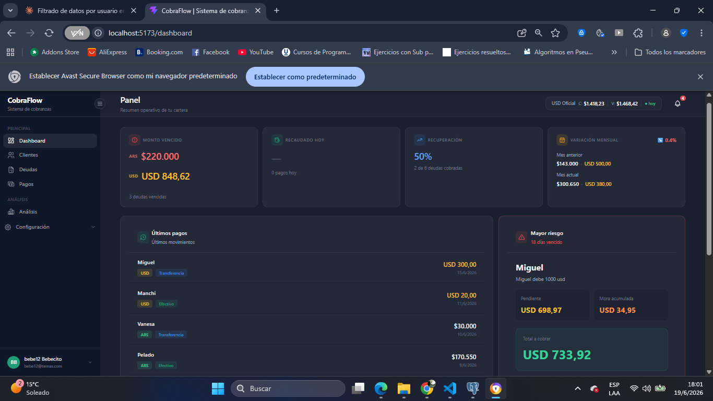
</div>

---

## 🚀 Demo

- **Frontend:** [https://TU-APP.vercel.app](https://TU-APP.vercel.app)
- **Backend API:** [https://cobraflow-api.onrender.com](https://cobraflow-api.onrender.com) (`/health` para health check)

> El backend corre en un plan gratuito: se apaga tras 15 minutos sin uso, así que la primera petición puede tardar cerca de un minuto. También podés ejecutar el proyecto localmente siguiendo los pasos de [Instalación](#-instalación).

---

## 📋 Tabla de Contenidos

- [Demo](#-demo)
- [Capturas](#-capturas)
- [Descripción](#-descripción)
- [Roadmap](#-roadmap)
- [Calidad y Estado del Proyecto](#-calidad-y-estado-del-proyecto)
- [Tecnologías](#-tecnologías)
- [Decisiones Técnicas](#-decisiones-técnicas)
- [Características](#-características)
- [Estructura del Proyecto](#-estructura-del-proyecto)
- [Arquitectura](#-arquitectura)
- [Flujo de Autenticación](#-flujo-de-autenticación)
- [Base de Datos](#-base-de-datos)
- [Performance](#-performance)
- [Seguridad](#-seguridad)
- [Requisitos Previos](#-requisitos-previos)
- [Instalación](#-instalación)
- [Configuración](#-configuración)
- [Ejecución](#-ejecución)
- [API Endpoints](#-api-endpoints)
- [Despliegue](#-despliegue)
- [Limitaciones Conocidas](#-limitaciones-conocidas)
- [Contribuir](#-contribuir)
- [Licencia](#-licencia)
- [Autor](#-autor)

---

## 🖼️ Capturas

<table>
  <tr>
    <td><br /><sub><b>Panel:</b> KPIs, últimos pagos y mayor riesgo</sub></td>
    <td>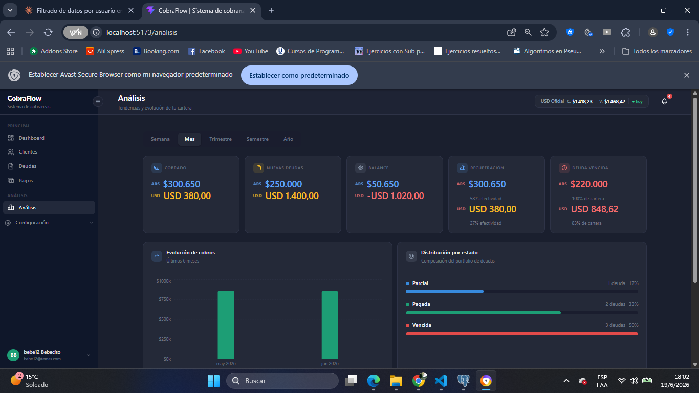<br /><sub><b>Análisis:</b> evolución, distribución y antigüedad</sub></td>
  </tr>
  <tr>
    <td>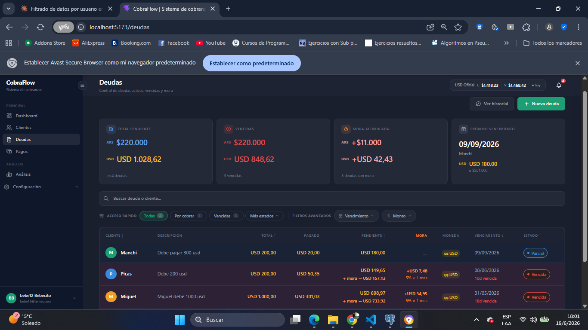<br /><sub><b>Deudas</b> en ARS y USD</sub></td>
    <td>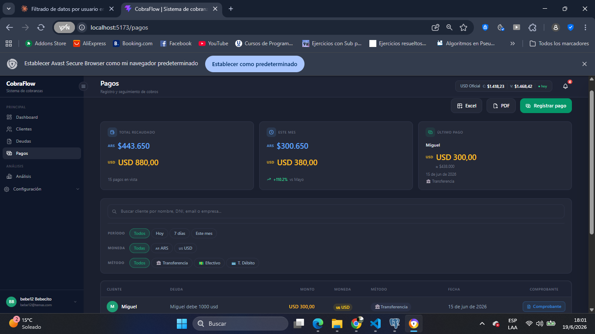<br /><sub><b>Pagos</b> con anulación</sub></td>
  </tr>
  <tr>
    <td>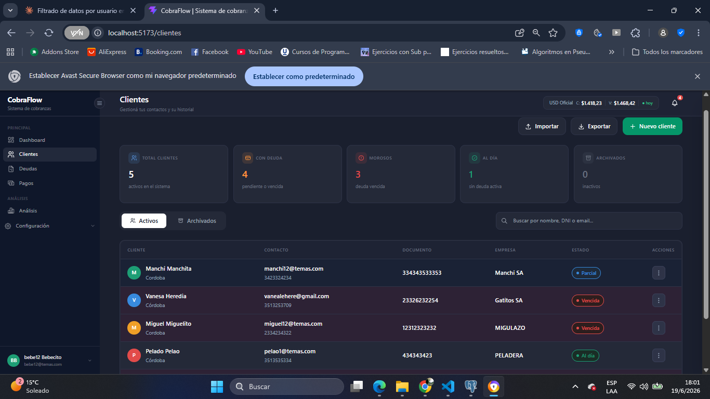<br /><sub><b>Clientes</b></sub></td>
    <td>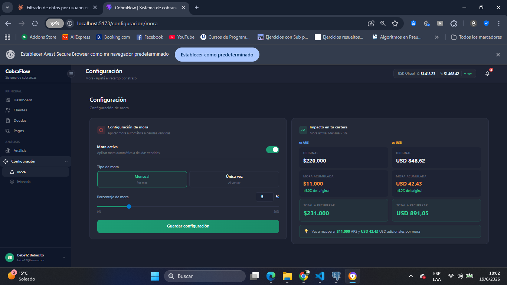<br /><sub><b>Configuración de mora</b></sub></td>
  </tr>
  <tr>
    <td colspan="2" align="center">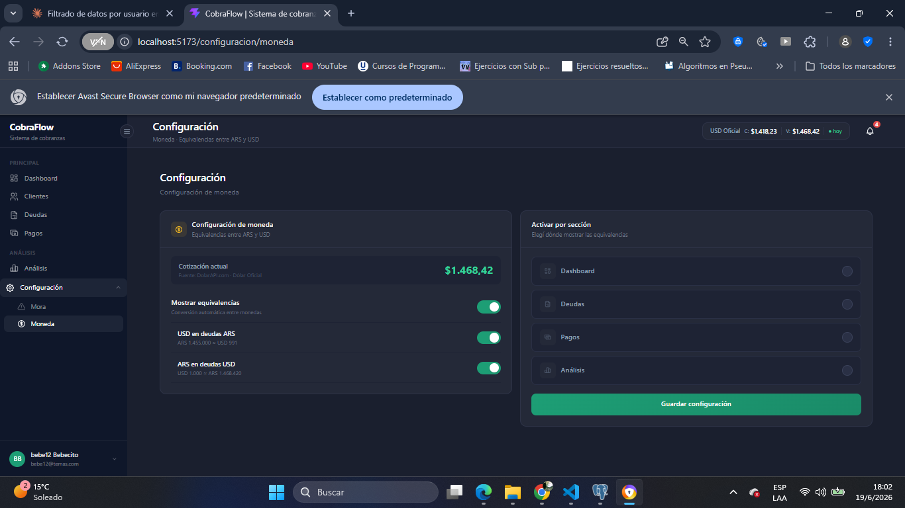<br /><sub><b>Configuración de moneda</b></sub></td>
  </tr>
</table>

---

## 📖 Descripción

**CobraFlow** es una aplicación web que centraliza las cuentas por cobrar de una pyme en un solo lugar. Lleva clientes, deudas y pagos en pesos y dólares, calcula la mora automáticamente, muestra el estado de la cartera en un panel y envía recordatorios por email antes de que una deuda se venza.

### Problema que resuelve

Muchas pymes llevan sus cobranzas en planillas: no saben qué vence esta semana, calculan la mora a mano y reclaman cuando el plazo ya pasó. Si además facturan en dólares, el saldo cambia con la cotización y los números dejan de cerrar. CobraFlow unifica todo: cada deuda tiene su estado, su saldo y su mora siempre al día.

### Stack

```
React → Axios → Express → PostgreSQL (Supabase)
                   ↑
     GitHub Actions (cron) → recordatorios por email (Resend)
```

### Características principales

✔ Clientes, deudas y pagos &nbsp; ✔ Deudas en ARS y USD &nbsp; ✔ Mora configurable
✔ Panel y análisis de cartera &nbsp; ✔ Cotización del dólar en vivo &nbsp; ✔ Recordatorios automáticos por email
✔ Autenticación JWT &nbsp; ✔ Reportes PDF y Excel &nbsp; ✔ Tema claro y oscuro

---

## 🚧 Roadmap

| Estado | Funcionalidad |
|--------|---------------|
| ✔ | Registro, login y rutas protegidas con JWT |
| ✔ | Clientes: alta, edición, archivado, importación CSV y exportación a Excel |
| ✔ | Deudas en ARS y USD con cotización guardada por movimiento |
| ✔ | Pagos con anulación y recálculo automático de saldo y estado |
| ✔ | Mora configurable (porcentaje y modalidad única o mensual) |
| ✔ | Panel con KPIs y análisis con gráficos y reporte de antigüedad |
| ✔ | Cotización del dólar oficial y blue con registro diario |
| ✔ | Notificaciones dentro de la aplicación |
| ✔ | Reportes en PDF y Excel |
| ✔ | Recordatorios automáticos por email con GitHub Actions |
| 🔲 | Tests automatizados (Jest y Supertest ya están como dependencias) |
| 🔲 | Modo demo con usuario de prueba y datos de ejemplo |
| 🔲 | Envío de avisos por WhatsApp Business |
| 🔲 | Cobro online con Mercado Pago y conciliación automática |
| 🔲 | Dominio propio verificado para enviar avisos a clientes reales |
| 🔲 | Code splitting y carga diferida de rutas |
| 🔲 | Token en cookie `httpOnly` |
| 🔲 | Modo `strict` de TypeScript en el backend |

---

## ✅ Calidad y Estado del Proyecto

| Chequeo | Backend | Frontend |
|---|---|---|
| Compilación TypeScript (`tsc`) | ✅ 0 errores | ✅ 0 errores (modo `strict`) |
| Build de producción | ✅ `tsc` → `dist/` | ✅ `vite build` (~4 s) |
| ESLint | Pendiente | Pendiente |
| Tests automatizados | Pendiente | Pendiente |
| Recordatorios por email probados de punta a punta (local) | ✅ | — |

> Los tests y el linter quedan documentados como mejora pendiente: hoy el proyecto se valida con compilación estricta en el frontend y pruebas manuales de los flujos críticos (login, alta de deuda, registro de pago y envío de recordatorios).

---

## 🛠️ Tecnologías

### Frontend

| Tecnología | Versión | Propósito |
|------------|---------|-----------|
| React | ^19.0.0 | UI library |
| TypeScript | ^5.9.3 | Tipado estático (modo `strict`) |
| Vite | ^8.0.8 | Build tool |
| React Router DOM | ^6.22.0 | Enrutamiento SPA |
| Tailwind CSS | ^3.4.19 | Estilos utilitarios |
| Axios | ^1.16.1 | Cliente HTTP con interceptores |
| Recharts | ^3.8.1 | Gráficos |
| jsPDF + autotable | ^4.2.1 / ^5.0.7 | Reportes en PDF |
| Sonner | ^2.0.7 | Notificaciones tipo *toast* |
| Lucide React / Tabler Icons | ^1.8.0 / ^3.44.0 | Iconos |

### Backend

| Tecnología | Versión | Propósito |
|------------|---------|-----------|
| Node.js | 22+ | Runtime |
| Express | ^4.18.0 | Framework web |
| TypeScript | ^5.0.0 | Tipado estático |
| Supabase JS | ^2.101.1 | Acceso a PostgreSQL |
| jsonwebtoken | ^9.0.0 | Autenticación stateless |
| bcryptjs | ^2.4.3 | Hash de contraseñas |
| express-rate-limit | ^8.5.2 | Límite de intentos en login y registro |
| Multer | ^2.1.1 | Carga de archivos CSV |
| node-cron | ^4.2.1 | Actualización de cotización en entorno local |
| Nodemailer | ^10 | Envío de emails por SMTP (alternativa local) |
| Helmet | ^8.1.0 | Instalado, no usado actualmente |
| Jest + Supertest | ^30 / ^7 | Instalados, sin tests todavía |

### Base de datos e infraestructura

| Servicio | Uso |
|----------|-----|
| Supabase (PostgreSQL) | Base de datos con triggers, columnas generadas, funciones y RLS |
| Resend | Envío de emails por API HTTPS |
| Vercel | Hosting del frontend |
| Render | Hosting del backend |
| GitHub Actions | Reloj diario que dispara los jobs |

---

## 🤔 Decisiones Técnicas

| Decisión | Motivo |
|----------|--------|
| **React + Vite** | HMR rápido, build optimizado y ecosistema maduro |
| **TypeScript** | Detecta errores en compilación y mejora el autocompletado |
| **PostgreSQL en Supabase** | Integridad referencial, columnas generadas y triggers para las reglas de negocio |
| **Reglas de negocio en la base de datos** | El saldo es una columna generada y un trigger recalcula monto pagado y estado en cada pago: la lógica no puede desincronizarse |
| **Autenticación propia con JWT** | Control total del flujo y de los roles, sin depender de Supabase Auth |
| **Acceso a datos solo a través de la API** | Las tablas tienen RLS activado y sin políticas: la clave pública del navegador no da acceso a nada, y el backend usa la *secret key* |
| **Cotización guardada en cada deuda y pago** | Los históricos no cambian cuando se mueve el dólar |
| **Mora sobre el monto total con invariante de no disminución** | Evita que un pago parcial achique la mora ya devengada |
| **Archivar en lugar de eliminar clientes** | Conserva el historial de deudas y pagos |
| **Jobs disparados desde GitHub Actions** | Render apaga los servicios gratuitos por inactividad, así que un `cron` dentro del proceso no corre. El reloj vive afuera y despierta al servidor |
| **Idempotencia con `UNIQUE (deuda_id, tipo)`** | Un aviso se envía una sola vez por deuda aunque el job corra varias veces o falle a mitad de camino |
| **Emails por API HTTPS (Resend)** | Render gratis bloquea los puertos SMTP; la API por HTTPS funciona en cualquier plan |
| **Estructura por *features*** | Cada módulo contiene sus componentes, hooks y servicios: bajo acoplamiento y fácil de escalar |

---

## ✨ Características

### Clientes
Alta, edición, búsqueda y filtros. En lugar de eliminarse, los clientes se **archivan** y se pueden restaurar. Importación masiva desde CSV, exportación a Excel y resumen financiero por cliente.

### Deudas
Deudas en pesos o dólares. Cada una guarda la cotización del momento de carga. Estados: pendiente, parcial, pagada y vencida, con saldo calculado en la base de datos e historial.

### Pagos
Múltiples métodos (efectivo, transferencia, tarjeta, cheque, Mercado Pago, entre otros). Un pago puede **anularse** indicando el motivo, y la deuda recalcula su saldo y su estado automáticamente.

### Mora
Configurable por usuario: porcentaje y modalidad (única o mensual). Se calcula sobre el monto total de la deuda y nunca disminuye una vez acumulada.

### Panel
Monto vencido, recaudado hoy, porcentaje de recuperación, variación mensual, últimos pagos y el cliente de mayor riesgo, con su mora acumulada y total a cobrar.

### Análisis
Períodos de semana a año. Evolución de cobros, distribución de la cartera por estado, reporte de antigüedad de deudas (*aging*), clientes en mora y proyección.

### Cotización del dólar
Consulta el dólar oficial y blue desde DolarAPI, guarda un registro diario y lo muestra en la barra superior. Las equivalencias ARS/USD se pueden activar o desactivar desde la configuración.

### Notificaciones
Dentro de la aplicación: deudas vencidas, que vencen hoy o pronto, pagos recientes y mora.

### Recordatorios por email
Un proceso diario mantiene al día los estados y la mora, y envía avisos según el vencimiento:

| Aviso | Cuándo se envía |
|---|---|
| Recordatorio previo | Cuando faltan entre 1 y 3 días para el vencimiento |
| Vencimiento | El día del vencimiento y durante la primera semana vencida |
| Mora | A partir de los 7 días vencida |

### Reportes
Exportación a PDF y Excel, y tema claro u oscuro.

---

## 📁 Estructura del Proyecto

```
CobraFlow/
├── backend/                          # API REST (Express + TypeScript)
│   ├── src/
│   │   ├── config/                   # Cliente de Supabase
│   │   ├── controllers/              # Lógica de cada módulo
│   │   ├── jobs/                     # Tarea programada de cotización (entorno local)
│   │   ├── middleware/               # Autenticación JWT y rate limiting
│   │   ├── routes/                   # Definición de endpoints
│   │   ├── services/                 # Cotización del dólar y recordatorios
│   │   ├── types/                    # Tipos compartidos
│   │   ├── utils/                    # Cálculo de mora y helpers
│   │   └── index.ts                  # Punto de entrada
│   └── package.json
│
├── frontend/                         # SPA (React + TypeScript + Vite)
│   ├── src/
│   │   ├── app/                      # Router y providers
│   │   ├── features/                 # Módulos funcionales
│   │   │   ├── analisis/             # Análisis de cartera
│   │   │   ├── auth/                 # Login y registro
│   │   │   ├── clientes/             # Gestión de clientes
│   │   │   ├── dashboard/            # Panel principal
│   │   │   ├── deudas/               # Gestión de deudas
│   │   │   ├── home/                 # Página de inicio
│   │   │   ├── pagos/                # Gestión de pagos
│   │   │   └── perfil/               # Perfil y configuración
│   │   ├── components/               # Layout, UI y componentes compartidos
│   │   ├── context/                  # Tema y configuración de moneda
│   │   ├── services/                 # Cliente HTTP
│   │   └── utils/                    # Generación de PDF y manejo de errores
│   ├── public/
│   └── package.json
│
├── database/
│   ├── schema.sql                    # Esquema completo de PostgreSQL
│   └── migrations/                   # Cambios incrementales
│
├── .github/workflows/                # Jobs diarios (GitHub Actions)
├── LICENSE
└── README.md
```

---

## 🏗️ Arquitectura

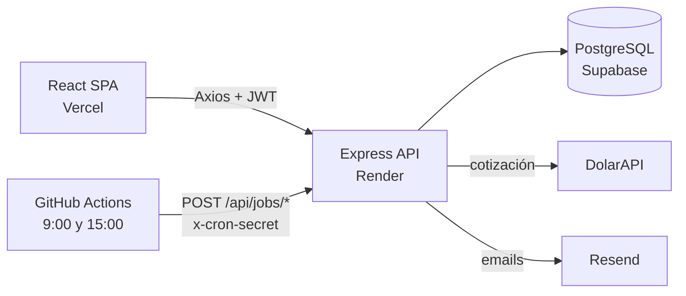

### Capas del Backend

```
routes/  →  controllers/  →  services/ y utils/  →  Supabase (PostgreSQL)
   ↓             ↓                  ↓
Auth + límites  Lógica HTTP     Lógica de negocio
```

### Automatización de recordatorios

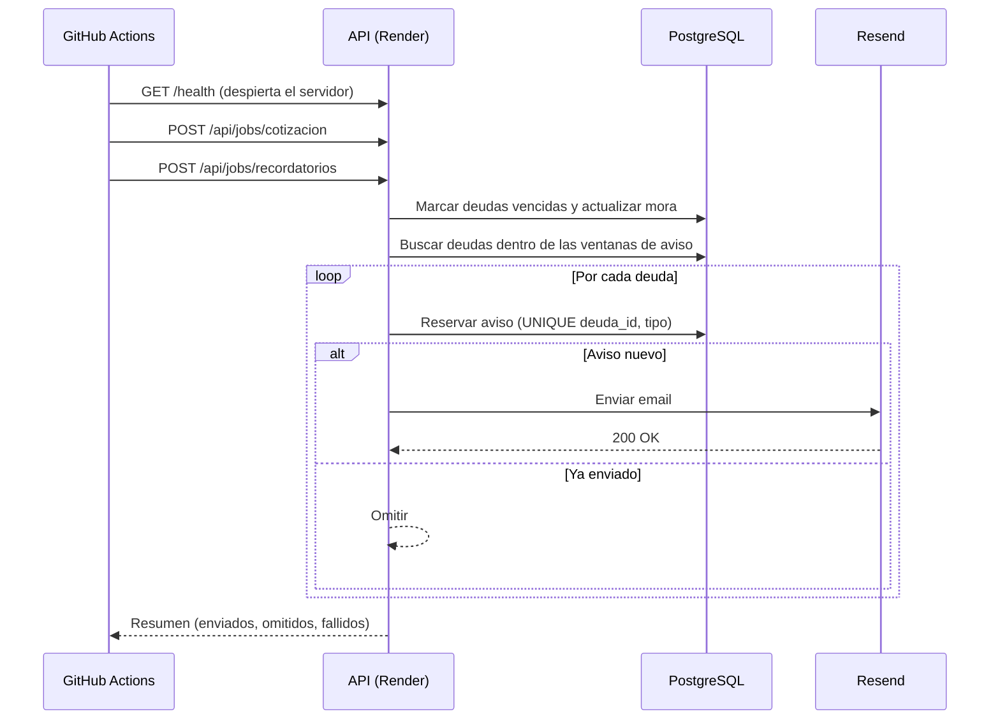

Si un envío falla, el aviso reservado se libera y se reintenta en la próxima corrida.

---

## 🔐 Flujo de Autenticación

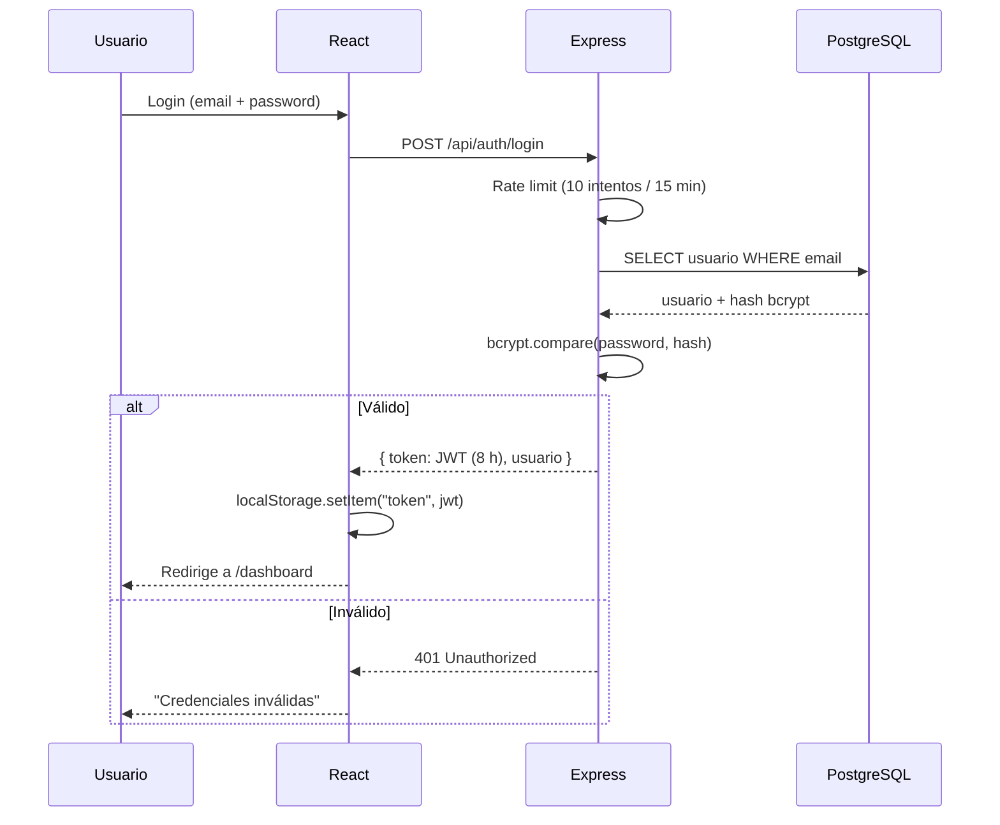

### Protección de rutas

```
Solicitud → Interceptor de Axios → Adjunta Bearer token → Express
                                                         → middleware verificarToken → Controller
¿401? → Interceptor → Elimina sesión → Redirige a /login
```

Las rutas administrativas (actualización manual de cotización) usan además el middleware `soloAdmin`.

---

## 🗄️ Base de Datos

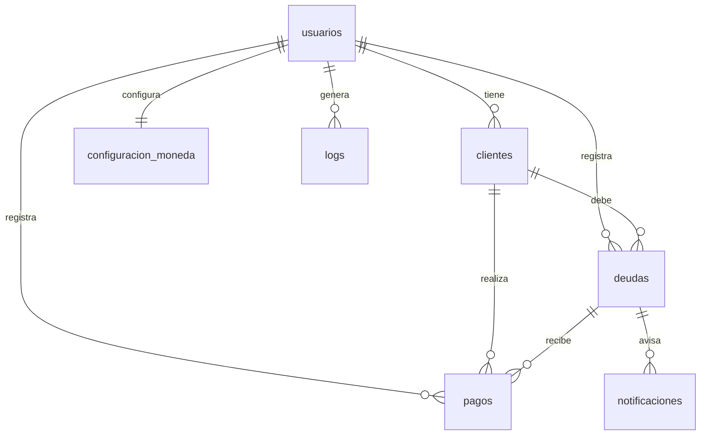

| Tabla | Descripción | Columnas clave |
|-------|-------------|----------------|
| `usuarios` | Usuarios y configuración de mora | email, password (bcrypt), rol, mora_activa, mora_porcentaje, mora_tipo |
| `clientes` | Clientes de cada usuario | nombre, apellido, dni o cuit, email, telefono, activo |
| `deudas` | Cuentas por cobrar | monto_total, monto_pagado, **saldo_pendiente** (generada), fecha_vencimiento, estado, moneda, cotizacion, monto_mora_acumulada |
| `pagos` | Pagos de cada deuda | monto, metodo_pago, moneda, cotizacion, anulado, anulado_motivo |
| `tipo_cambio` | Cotización diaria del dólar | fecha (única), compra, venta, fuente |
| `configuracion_moneda` | Preferencias de visualización | mostrar_equivalencias, secciones activas |
| `notificaciones` | Avisos enviados por email | deuda_id, tipo, destinatario, enviada_at. **UNIQUE (deuda_id, tipo)** |
| `logs` | Registro de acciones | accion, entidad, detalles (JSONB), nivel |

### Lógica en la base de datos

| Elemento | Qué hace |
|----------|----------|
| `saldo_pendiente` | Columna generada: `monto_total - monto_pagado` |
| `actualizar_saldo_deuda()` | Trigger sobre `pagos`: recalcula monto pagado, estado y fecha de pago real (ignora pagos anulados) |
| `actualizar_deudas_vencidas()` | Marca como vencidas las deudas con saldo y fecha pasada |
| `guardar_cotizacion()` | Inserta o actualiza la cotización del día |
| `actualizar_updated_at()` | Trigger que mantiene `updated_at` |

---

## ⚡ Performance

| Técnica | Implementación |
|---------|---------------|
| Índices | En las columnas de consulta frecuente (usuario, cliente, estado, vencimiento, fecha de pago) |
| Columnas generadas | El saldo se calcula una vez en la base y no en cada consulta |
| Cotización persistida | Un registro por día en `tipo_cambio`, sin consultar la API externa en cada pantalla |
| Paginación y filtros | Componentes de paginación y filtros en los listados |
| Build | Vite con minificación y compresión |

> Mejora pendiente: el bundle principal pesa cerca de 1,3 MB (≈ 400 KB comprimido). Dividirlo con carga diferida de rutas está en el roadmap.

---

## 🛡️ Seguridad

| Medida | Detalle |
|--------|---------|
| **JWT** | Tokens con expiración de 8 horas, verificados en cada request protegido |
| **bcrypt** | Contraseñas hasheadas con salt (10 rondas) |
| **Rate limiting** | Máximo 10 intentos cada 15 minutos por IP en login y registro |
| **RLS en la base** | Activado en todas las tablas y sin políticas: la API pública de Supabase no expone datos |
| **Secret key solo en el backend** | El frontend usa la clave pública y nunca consulta la base directamente |
| **Roles** | Las rutas de administración exigen rol `admin` |
| **Aislamiento por usuario** | Cada consulta del backend filtra por el usuario autenticado |
| **CORS** | Solo permite los orígenes definidos en `FRONTEND_URL` |
| **Jobs protegidos** | Los endpoints `/api/jobs/*` exigen un secreto compartido, comparado en tiempo constante |
| **Sanitización** | Los filtros de búsqueda se sanitizan antes de armar las consultas y los textos de los emails se escapan |
| **Secretos fuera del repo** | Variables de entorno con `.env.example` por aplicación; historial de git auditado con `gitleaks` |

---

## 📋 Requisitos Previos

- **Node.js** v22 o superior
- **npm**
- Una cuenta gratuita de **[Supabase](https://supabase.com)**
- *(Opcional)* una cuenta gratuita de **[Resend](https://resend.com)** para probar los recordatorios por email

---

## 🔧 Instalación

```bash
# 1. Clonar
git clone https://github.com/gperalta149-stack/CobraFlow.git
cd CobraFlow

# 2. Instalar dependencias
cd backend && npm install
cd ../frontend && npm install
cd ..
```

### Base de datos

1. Creá un proyecto nuevo en Supabase.
2. Abrí **SQL Editor**, pegá el contenido de [`database/schema.sql`](database/schema.sql) y ejecutalo.
3. En **Project Settings → API Keys**, copiá la *publishable key* y creá una *secret key*.

```bash
# 3. Variables de entorno
cp backend/.env.example backend/.env       # en Windows: copy backend\.env.example backend\.env
cp frontend/.env.example frontend/.env     # en Windows: copy frontend\.env.example frontend\.env
```

> ⚠️ **Nunca subas un `.env` con valores reales.** Usá siempre el `.env.example` como plantilla; el `.gitignore` ya excluye los `.env`.

---

## ⚙️ Configuración

`backend/.env`:

```env
PORT=3000
FRONTEND_URL=http://localhost:5173
SUPABASE_URL=https://tu-proyecto.supabase.co
SUPABASE_SERVICE_ROLE_KEY=sb_secret_...
JWT_SECRET=genera_un_secreto_largo_y_aleatorio
CRON_SECRET=otro_secreto_largo_y_aleatorio
RESEND_API_KEY=re_...
MAIL_FROM=CobraFlow <onboarding@resend.dev>
RECORDATORIOS_DESTINO_OVERRIDE=tu-correo@ejemplo.com
```

Para generar un secreto fuerte:

```bash
node -e "console.log(require('crypto').randomBytes(48).toString('hex'))"
```

`frontend/.env`:

```env
VITE_API_URL=http://localhost:3000/api
```

### Variables de entorno del backend

| Variable | Requerida | Default | Descripción |
|----------|-----------|---------|-------------|
| `SUPABASE_URL` | Sí | — | URL del proyecto de Supabase |
| `SUPABASE_SERVICE_ROLE_KEY` | Sí | — | *Secret key* de Supabase. Nunca en el frontend |
| `JWT_SECRET` | Sí | — | Secreto para firmar los tokens |
| `PORT` | No | `3000` | Puerto de Express |
| `FRONTEND_URL` | No | `http://localhost:5173` | Origen permitido por CORS. Admite varios, separados por coma |
| `CRON_SECRET` | Para jobs | — | Secreto que protege `/api/jobs/*` |
| `RESEND_API_KEY` | Para emails | — | Clave de Resend. Si está definida, los emails salen por su API |
| `MAIL_FROM` | Para emails | — | Remitente, por ejemplo `CobraFlow <onboarding@resend.dev>` |
| `SMTP_USER` / `SMTP_PASS` | No | — | Alternativa local por SMTP si no se usa Resend |
| `RECORDATORIOS_DESTINO_OVERRIDE` | No | — | Si se define, todos los avisos llegan a esta casilla (modo demo) |

### Variables de entorno del frontend

| Variable | Requerida | Default | Descripción |
|----------|-----------|---------|-------------|
| `VITE_API_URL` | No | `http://localhost:3000/api` | URL base de la API |
| `VITE_SUPABASE_URL` / `VITE_SUPABASE_ANON_KEY` | No | — | Reservadas para un cliente de Supabase en el frontend, hoy sin uso |

> Sin dominio propio verificado, Resend solo entrega al correo con el que se registró la cuenta. Por eso la configuración recomendada para probar es usar `RECORDATORIOS_DESTINO_OVERRIDE` con ese mismo correo.

---

## 🚀 Ejecución

### Desarrollo

```bash
# Backend (hot-reload)
cd backend && npm run dev      # http://localhost:3000

# Frontend (HMR)
cd frontend && npm run dev     # http://localhost:5173
```

### Producción

```bash
cd backend && npm run build && npm start
cd frontend && npm run build && npm run preview
```

### Primer uso y prueba de recordatorios

1. Entrá a `http://localhost:5173/register` y creá tu usuario.
2. Cargá un cliente con email y una deuda que venza dentro de 1 a 3 días.
3. Disparar el proceso a mano:

```bash
curl -X POST http://localhost:3000/api/jobs/recordatorios \
  -H "x-cron-secret: TU_CRON_SECRET"
```

La respuesta indica cuántos avisos se enviaron, omitieron o fallaron:

```json
{ "ok": true, "usuariosConMoraActualizada": 0, "avisosEnviados": 1, "avisosOmitidos": 0, "avisosFallidos": 0 }
```

---

## 🌐 API Endpoints

Las rutas marcadas con **Sí** requieren el encabezado `Authorization: Bearer <token>`.

### Salud

| Método | Endpoint | Auth | Descripción |
|--------|----------|------|-------------|
| GET | `/health` | — | Health check |

### Autenticación (`/api/auth`)

| Método | Endpoint | Auth | Descripción |
|--------|----------|------|-------------|
| POST | `/api/auth/register` | — | Registro (con rate limit) |
| POST | `/api/auth/login` | — | Login (con rate limit) |
| PUT | `/api/auth/perfil` | Sí | Actualizar perfil |
| PUT | `/api/auth/cambiar-password` | Sí | Cambiar contraseña |
| GET | `/api/auth/mora` | Sí | Obtener configuración de mora |
| PUT | `/api/auth/mora` | Sí | Actualizar configuración de mora |
| GET | `/api/auth/moneda` | Sí | Obtener configuración de moneda |
| PUT | `/api/auth/moneda` | Sí | Actualizar configuración de moneda |

### Clientes (`/api/clientes`)

| Método | Endpoint | Auth | Descripción |
|--------|----------|------|-------------|
| GET | `/api/clientes` | Sí | Listar |
| GET | `/api/clientes/archivados` | Sí | Listar archivados |
| GET | `/api/clientes/export/excel` | Sí | Exportar a Excel |
| GET | `/api/clientes/:id` | Sí | Obtener uno |
| GET | `/api/clientes/:id/resumen-financiero` | Sí | Resumen financiero del cliente |
| POST | `/api/clientes` | Sí | Crear |
| POST | `/api/clientes/import/csv` | Sí | Importar desde CSV |
| PUT | `/api/clientes/:id` | Sí | Actualizar |
| POST | `/api/clientes/:id/archivar` | Sí | Archivar |
| POST | `/api/clientes/:id/restaurar` | Sí | Restaurar |

### Deudas (`/api/deudas`)

| Método | Endpoint | Auth | Descripción |
|--------|----------|------|-------------|
| GET | `/api/deudas` | Sí | Listar |
| GET | `/api/deudas/historial` | Sí | Historial de deudas |
| GET | `/api/deudas/:id` | Sí | Obtener una |
| POST | `/api/deudas` | Sí | Crear |
| PUT | `/api/deudas/:id` | Sí | Actualizar |
| DELETE | `/api/deudas/:id` | Sí | Eliminar |

### Pagos (`/api/pagos`)

| Método | Endpoint | Auth | Descripción |
|--------|----------|------|-------------|
| GET | `/api/pagos` | Sí | Listar |
| GET | `/api/pagos/cliente/:cliente_id` | Sí | Pagos de un cliente |
| POST | `/api/pagos` | Sí | Registrar |
| PUT | `/api/pagos/:id/anular` | Sí | Anular con motivo |

### Panel (`/api/dashboard`)

| Método | Endpoint | Auth | Descripción |
|--------|----------|------|-------------|
| GET | `/api/dashboard` | Sí | Métricas del panel |
| GET | `/api/dashboard/evolucion-pagos` | Sí | Evolución de pagos |

### Cotización (`/api/exchange-rate`)

| Método | Endpoint | Auth | Descripción |
|--------|----------|------|-------------|
| GET | `/api/exchange-rate/current` | — | Cotización vigente |
| GET | `/api/exchange-rate/stored` | Sí | Cotización guardada |
| POST | `/api/exchange-rate/save` | Admin | Guardar cotización manualmente |
| POST | `/api/exchange-rate/force-update` | Admin | Forzar actualización |

### Jobs (`/api/jobs`)

Protegidos con el encabezado `x-cron-secret` en lugar de un token de usuario.

| Método | Endpoint | Auth | Descripción |
|--------|----------|------|-------------|
| POST | `/api/jobs/cotizacion` | Secreto | Actualizar la cotización del dólar |
| POST | `/api/jobs/recordatorios` | Secreto | Actualizar estados y mora, y enviar recordatorios |

---

## 📦 Despliegue

### Producción actual

La aplicación está desplegada con un esquema desacoplado:

| Componente | Servicio | URL |
|------------|----------|-----|
| Frontend | Vercel | https://TU-APP.vercel.app |
| Backend | Render | https://cobraflow-api.onrender.com |
| Base de datos | Supabase | — |
| Emails | Resend | — |
| Jobs diarios | GitHub Actions | `.github/workflows/jobs-diarios.yml` |

### Frontend en Vercel

- **Root Directory:** `frontend`
- **Framework:** Vite (detectado automáticamente)
- **Variable de entorno:** `VITE_API_URL=https://cobraflow-api.onrender.com/api`

El archivo `frontend/vercel.json` redirige todas las rutas a `index.html` para que la navegación de la SPA funcione al recargar.

### Backend en Render

- **Root Directory:** `backend`
- **Build Command:** `npm install --include=dev && npm run build`
- **Start Command:** `npm start`
- **Variables:** las de la sección [Configuración](#-configuración), con `FRONTEND_URL` apuntando a la URL de Vercel

### Reloj diario (GitHub Actions)

Cargar en **Settings → Secrets and variables → Actions**:

| Secret | Valor |
|--------|-------|
| `API_URL` | URL del backend, sin barra final |
| `CRON_SECRET` | El mismo valor que en Render |

El workflow corre a las 9:00 y 15:00 (hora de Argentina) y también se puede lanzar a mano desde la pestaña **Actions**.

---

## ⚠️ Limitaciones Conocidas

Documentadas de forma explícita para ser transparente sobre el alcance actual:

- CobraFlow **registra** los pagos pero no los procesa: no hay pasarela de pagos integrada.
- El backend corre en un plan gratuito que se apaga por inactividad: la primera petición después de un rato puede tardar cerca de un minuto.
- Sin un dominio propio verificado en Resend, los emails solo se entregan al correo del titular de la cuenta. Por eso el modo demo redirige todos los avisos a una casilla propia.
- El JWT se guarda en `localStorage` y no en una cookie `httpOnly`, lo que aumenta la exposición ante XSS. Migrar a cookies `httpOnly` queda como mejora.
- No hay tests automatizados todavía, y ESLint no está configurado. Jest y Supertest están instalados para sumarlos.
- El modo `strict` de TypeScript está activo en el frontend, pero no en el backend.
- `helmet` y el cliente de Supabase del frontend están instalados pero no se usan actualmente.
- El bundle del frontend es un único archivo de cerca de 1,3 MB, sin carga diferida de rutas.
- La tarea programada de cotización dentro del proceso (`node-cron`) solo corre mientras el servidor está despierto. En producción la cotización se actualiza desde GitHub Actions.

---

## 🤝 Contribuir

1. Fork del repositorio
2. Rama: `git checkout -b feature/nueva-funcionalidad`
3. Commit: `git commit -m 'feat: agrega nueva funcionalidad'`
4. Push: `git push origin feature/nueva-funcionalidad`
5. Pull Request

### Convenciones

- TypeScript, evitando `any`
- Interfaz y código en español
- Un módulo por *feature* en el frontend
- Commits semánticos: `feat:`, `fix:`, `refactor:`, `chore:`

---

## 📄 Licencia

MIT. Ver el archivo [LICENSE](LICENSE).

---

## 👤 Autor

**Guillermo Peralta** — [GitHub](https://github.com/gperalta149-stack) · [LinkedIn](https://www.linkedin.com/in/TU-PERFIL) · [Email](mailto:TU-EMAIL)

Proyecto desarrollado como Trabajo Final Integrador de la TUIDAI (IUA), con foco en arquitectura full-stack, automatización de procesos y un caso de uso real del contexto argentino: cobranzas en pesos y dólares.

---

<div align="center">
  <p>Hecho con ❤️ para ordenar las cobranzas de las pymes</p>
</div>
