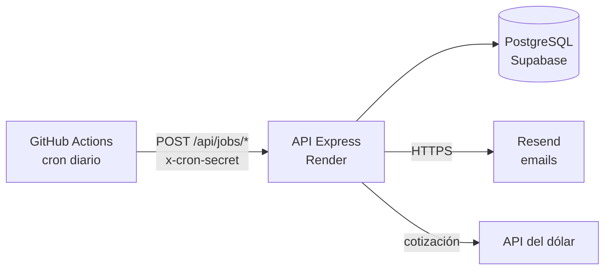
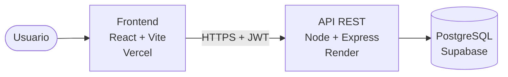

# CobraFlow

**Sistema de gestión de cobranzas para pymes argentinas.** Centraliza clientes, deudas y pagos en pesos y dólares, calcula la mora automáticamente y avisa por email cuando una deuda está por vencer.


> Proyecto final integrador (TFI) de la TUIDAI — IUA.

<p align="center">
  
</p>

## Demo

| | |
|---|---|
| Aplicación | https://TU-APP.vercel.app |
| API | https://cobraflow-api.onrender.com |

> La API corre en un plan gratuito: se apaga tras 15 minutos sin uso y la primera petición puede tardar cerca de un minuto en responder.

## El problema

Muchas pymes llevan sus cuentas por cobrar en planillas: no saben qué deudas vencen esta semana, calculan la mora a mano y se acuerdan de reclamar cuando ya pasó el plazo. Si además facturan en dólares, el saldo cambia con la cotización y los números dejan de cerrar.

CobraFlow resuelve eso en una sola herramienta: cada deuda tiene su estado, su saldo y su mora siempre al día, y el sistema avisa antes de que el cliente se atrase.

## Funcionalidades

**Cartera**
- **Clientes:** alta, edición y búsqueda con filtros. En lugar de eliminarse, se archivan y se pueden restaurar. Importación desde CSV, exportación a Excel y resumen financiero por cliente.
- **Deudas en ARS y USD:** cada deuda guarda la cotización del momento en que se cargó. Los estados son pendiente, parcial, pagada y vencida, y el saldo se calcula en la base de datos.
- **Pagos:** múltiples métodos (efectivo, transferencia, Mercado Pago, cheque, entre otros). Un pago se puede anular indicando el motivo, y la deuda recalcula su saldo y su estado sola.

**Mora y moneda**
- **Mora configurable por usuario:** porcentaje y modalidad (única o mensual). Se calcula sobre el monto total de la deuda y nunca disminuye una vez acumulada.
- **Cotización del dólar:** se consulta una API pública, se guarda un registro diario y se muestra en la barra superior. Las equivalencias ARS/USD se pueden activar o no desde la configuración.

**Visibilidad**
- **Panel:** monto vencido, recaudado hoy, porcentaje de recuperación, variación mensual, últimos pagos y el cliente de mayor riesgo.
- **Análisis:** períodos de semana a año, evolución de cobros, distribución por estado, reporte de antigüedad de deudas (*aging*), clientes en mora y proyección.
- **Notificaciones en la app:** deudas vencidas, que vencen hoy o pronto, pagos recientes y mora.
- **Reportes** en PDF y Excel, y tema claro u oscuro.

## Automatización de recordatorios

El sistema envía avisos por email sin que nadie abra la aplicación:

| Aviso | Cuándo se envía |
|---|---|
| Recordatorio previo | Cuando faltan entre 1 y 3 días para el vencimiento |
| Vencimiento | El día del vencimiento y durante la primera semana vencida |
| Mora | A partir de los 7 días vencida |

Además, el mismo proceso mantiene al día los estados de las deudas, la mora acumulada y la cotización del dólar.



Decisiones de diseño:

- **El reloj vive fuera del servidor.** Render apaga los servicios gratuitos por inactividad, así que un `cron` dentro del proceso no se ejecutaría. Un workflow de GitHub Actions despierta el servidor y dispara los jobs dos veces por día (9:00 y 15:00, hora de Argentina).
- **Cada aviso se envía una sola vez por deuda.** Una restricción `UNIQUE (deuda_id, tipo)` en la tabla `notificaciones` hace el proceso idempotente: puede correr varias veces o fallar a mitad de camino sin duplicar mails.
- **Si un envío falla, el aviso se libera** y se reintenta en la próxima corrida.
- **Los endpoints de jobs están protegidos** con un secreto compartido que se compara en tiempo constante.
- **Modo demo:** con `RECORDATORIOS_DESTINO_OVERRIDE`, todos los mails llegan a una casilla propia y ningún cliente recibe nada. Es la configuración recomendada para probar.

## Arquitectura



Monorepo con dos aplicaciones independientes:

```
CobraFlow/
├── backend/                 API REST (Node.js + Express + TypeScript)
│   └── src/
│       ├── config/          Cliente de Supabase
│       ├── controllers/     Lógica de cada módulo
│       ├── routes/          Definición de endpoints
│       ├── middleware/      Autenticación JWT y rate limiting
│       ├── services/        Cotización del dólar y recordatorios
│       ├── jobs/            Tareas programadas
│       └── utils/           Cálculo de mora y helpers
├── frontend/                SPA (React + TypeScript + Vite)
│   └── src/
│       ├── app/             Router y providers
│       ├── features/        Un módulo por sección (auth, clientes, deudas, pagos, análisis...)
│       ├── components/      Componentes compartidos y de interfaz
│       └── services/        Cliente HTTP
├── database/
│   ├── schema.sql           Esquema completo de PostgreSQL
│   └── migrations/          Cambios incrementales
└── .github/workflows/       Jobs diarios
```

## Decisiones técnicas

- **Autenticación propia con JWT.** Las contraseñas se guardan con `bcrypt` y el login tiene *rate limiting* (10 intentos cada 15 minutos por IP).
- **Reglas de negocio en la base de datos.** El saldo pendiente es una columna generada, y un trigger recalcula el monto pagado y el estado de la deuda cada vez que se registra, modifica o anula un pago.
- **Acceso a datos solo a través de la API.** El frontend nunca consulta la base: las tablas tienen RLS activado y sin políticas, así que la clave pública no da acceso a nada. El backend usa la *secret key* de Supabase y filtra por usuario en cada consulta.
- **Los históricos no cambian.** La cotización se guarda en cada deuda y en cada pago, de modo que un movimiento viejo no se altera cuando sube el dólar.
- **Mora con invariante explícito.** Se calcula sobre el monto total, no sobre el saldo, y la mora persistida nunca disminuye.
- **Seguridad básica del repositorio.** Los secretos viven en variables de entorno (hay un `.env.example` por aplicación), el historial de git fue auditado con `gitleaks` y los textos que se insertan en los emails se escapan.

## Stack

| Capa | Tecnologías |
|---|---|
| Frontend | React 19, TypeScript, Vite, React Router, Tailwind CSS, Recharts, Axios, jsPDF, Sonner |
| Backend | Node.js, Express, TypeScript, JSON Web Tokens, bcryptjs, express-rate-limit, Multer |
| Base de datos | PostgreSQL en Supabase (triggers, columnas generadas, funciones, RLS) |
| Emails | Resend (API HTTPS), con SMTP como alternativa local |
| Infraestructura | Vercel, Render, GitHub Actions |

## Capturas

<table>
  <tr>
    <td><br><sub>Análisis de la cartera</sub></td>
    <td><br><sub>Deudas</sub></td>
  </tr>
  <tr>
    <td><br><sub>Pagos</sub></td>
    <td><br><sub>Clientes</sub></td>
  </tr>
  <tr>
    <td><br><sub>Configuración de mora</sub></td>
    <td><br><sub>Configuración de moneda</sub></td>
  </tr>
</table>

## Cómo correrlo en tu máquina

**Requisitos:** Node.js 22 o superior y una cuenta gratuita de [Supabase](https://supabase.com).

**1. Clonar el repositorio**

```bash
git clone https://github.com/gperalta149-stack/CobraFlow.git
cd CobraFlow
```

**2. Crear la base de datos.** En un proyecto nuevo de Supabase, abrí **SQL Editor**, pegá el contenido de [`database/schema.sql`](database/schema.sql) y ejecutalo.

**3. Backend**

```bash
cd backend
npm install
cp .env.example .env     # en Windows: copy .env.example .env
npm run dev              # http://localhost:3000
```

Completá el `.env`:

| Variable | Descripción |
|---|---|
| `SUPABASE_URL` | URL de tu proyecto de Supabase |
| `SUPABASE_SERVICE_ROLE_KEY` | *Secret key* de Supabase (`sb_secret_...`). Nunca en el frontend |
| `JWT_SECRET` | Cadena larga y aleatoria para firmar los tokens |
| `FRONTEND_URL` | Origen permitido por CORS. Admite varios, separados por coma |
| `CRON_SECRET` | Secreto que protege los endpoints `/api/jobs/*` |
| `RESEND_API_KEY` | Clave de Resend para enviar emails |
| `MAIL_FROM` | Remitente, por ejemplo `CobraFlow <onboarding@resend.dev>` |
| `RECORDATORIOS_DESTINO_OVERRIDE` | Si se define, todos los avisos llegan a esta casilla (modo demo) |

Para generar un secreto aleatorio:

```bash
node -e "console.log(require('crypto').randomBytes(48).toString('hex'))"
```

**4. Frontend**

```bash
cd frontend
npm install
cp .env.example .env
npm run dev              # http://localhost:5173
```

| Variable | Descripción |
|---|---|
| `VITE_API_URL` | URL de la API, por ejemplo `http://localhost:3000/api` |
| `VITE_SUPABASE_URL` | URL de tu proyecto de Supabase |
| `VITE_SUPABASE_ANON_KEY` | *Publishable key* de Supabase (`sb_publishable_...`) |

**5. Primer uso.** Entrá a `http://localhost:5173/register`, creá tu usuario y cargá un cliente con email y una deuda que venza dentro de un par de días.

**6. Probar los recordatorios**

```bash
curl -X POST http://localhost:3000/api/jobs/recordatorios \
  -H "x-cron-secret: TU_CRON_SECRET"
```

La respuesta indica cuántos avisos se enviaron, omitieron o fallaron.

## API

Todas las rutas, salvo las indicadas, requieren un token JWT en el encabezado `Authorization: Bearer <token>`.

| Módulo | Prefijo | Qué ofrece |
|---|---|---|
| Autenticación | `/api/auth` | Registro, login, perfil, cambio de contraseña, configuración de mora y de moneda |
| Clientes | `/api/clientes` | CRUD, archivar y restaurar, importar CSV, exportar a Excel, resumen financiero |
| Deudas | `/api/deudas` | CRUD e historial |
| Pagos | `/api/pagos` | Alta, consulta por cliente y anulación |
| Panel | `/api/dashboard` | Métricas y evolución de pagos |
| Cotización | `/api/exchange-rate` | Cotización vigente (pública), registro guardado y actualización manual (solo admin) |
| Jobs | `/api/jobs` | `POST /recordatorios` y `POST /cotizacion`, protegidos con `x-cron-secret` |
| Estado | `/health` | Verificación de que el servidor está activo (pública) |

## Próximos pasos

- [ ] Tests de integración del backend (Jest y Supertest ya están como dependencias).
- [ ] Modo demo con usuario de prueba y datos de ejemplo.
- [ ] Envío por WhatsApp Business.
- [ ] Cobro online con Mercado Pago y conciliación automática de pagos.
- [ ] Dominio propio verificado para enviar avisos a los clientes reales.
- [ ] Activar el modo `strict` de TypeScript en todo el backend.

## Autor

**Guille** — Desarrollador de software, egresado de la TUIDAI (IUA).

- GitHub: [@gperalta149-stack](https://github.com/gperalta149-stack)
- LinkedIn: https://www.linkedin.com/in/TU-PERFIL
